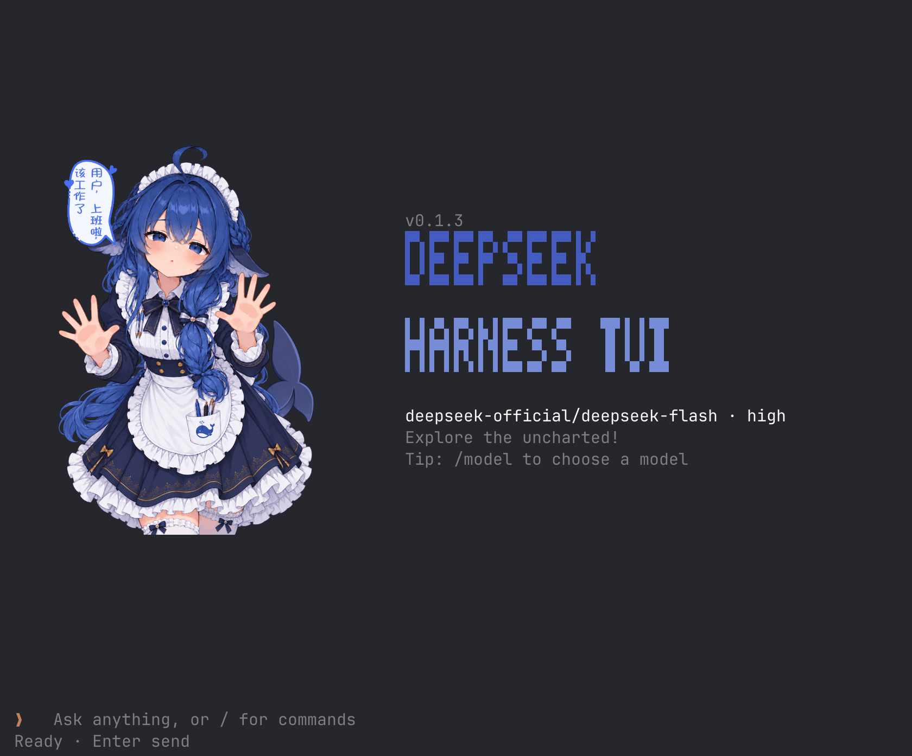

# DeepSeek Harness TUI

A terminal interface for [DeepSeek Harness](https://github.com/deepseek-ai/deepseek-harness).

<p align="center">
  
</p>

## Installation

Requires Node.js **22.19.0 or later** and pnpm on your `PATH`.

Configure your provider credentials in Harness, or set the `DEEPSEEK_API_KEY` environment variable.

Development baseline: DeepSeek Harness **0.2.1-rc.2**.

### npm

Install the Harness CLI and TUI globally:

```sh
npm install -g @deepseek-ai/dsh @nickyuan/deepseek-harness-tui
```

Run from your project directory:

```sh
deepseek-harness-tui
```

The first launch automatically sets up a dedicated Harness profile. Settings and sessions are saved in `~/.dsh`.

**Update**

Close the TUI before updating:

```sh
npm install -g @nickyuan/deepseek-harness-tui@latest
deepseek-harness-tui
```

### Source

Create a workspace with both repositories as sibling directories. `npm run setup` expects this layout by default:

```sh
mkdir harness-workspace
cd harness-workspace

git clone https://github.com/deepseek-ai/deepseek-harness.git
git clone https://github.com/zhenyuan2/deepseek-harness-tui.git
```

Build the Harness runtime:

```sh
cd deepseek-harness
pnpm install
pnpm run build
```

Install and start the TUI:

```sh
cd deepseek-harness-tui
npm install
npm run setup
npm run build
npm start
```

By default, `npm run setup` links to `../deepseek-harness`. For a different Harness location, use `npm run setup -- /path/to/deepseek-harness`. When running from source, settings and sessions are stored in `.dsh-home/`.

## Keyboard shortcuts

Type `/help` in the TUI to see all commands and shortcuts.

| Shortcut | Action |
| --- | --- |
| `Ctrl+J` or `Alt+Enter` | Insert a newline for multiline input |
| `Home` or `Ctrl+A` | Move to the start of the current line |
| `End` or `Ctrl+E` | Move to the end of the current line |
| `Ctrl+Home` | Move to the start of the entire input |
| `Ctrl+End` | Move to the end of the entire input |
| `Ctrl+U` | Clear all input text and image attachments |
| `Alt+←` / `Alt+→` | Move backward / forward by word |
| `Ctrl+V` or `Alt+V` | Attach an image from the clipboard |
| `F2` | Toggle live details |
| `Ctrl+L` | Clear the screen while idle, keeping the conversation |

Line navigation follows explicit newlines, rather than automatic wrapping. In multiline input, `Ctrl+A` / `Ctrl+E` stay on the current line, while `Ctrl+Home` / `Ctrl+End` jump to the boundaries of the entire input. Inside a picker, `Ctrl+U` clears its search query.

On a MacBook, `Alt` is `Option`, `Home` is usually `Fn+←`, and `End` is usually `Fn+→`. Use `Ctrl+Fn+←` / `Ctrl+Fn+→` to jump to the start / end of the entire input, and `Ctrl+J` or `Option+Enter` to insert a newline. Shortcut availability depends on your terminal's key mappings.
